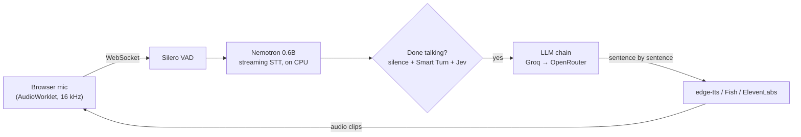

# Practice Studio

**[Try it live](https://shiivamchauhan-voice-agent.hf.space)** (free hosting, so give it two minutes if it was asleep)

It runs on a laptop CPU and costs ₹0. Speech recognition is local, and the LLMs and voices use free tiers,
switching to the next key whenever one runs dry.

## Modes

- **🎯 Interview:** reads your JD, resume and project repos, plans fresh questions, interviews you by voice,
  then writes a hiring-manager report.
- **📞 Phone call:** a random caller rings you (delivery guy, recruiter, scammer...), or you have to call
  someone and get a thing done. Phone-line audio included, awkward silences optional.
- **💬 Conversation:** chat with a stranger whose accent, age, job and personality you design.

Every session ends with a detailed feedback plus a speech report: how nervous you sounded, and
whether you settled down.

## How it works



## Run it

```powershell
start.bat        # sets everything up, then opens http://127.0.0.1:8000 (Chrome/Edge)
```

Put your keys in `.env` (copy `.env.example`). Every `*_API_KEYS` takes a comma-separated list:

| Key | For |
|---|---|
| `GROQ_API_KEYS` | the brain + Whisper |
| `OPENROUTER_API_KEYS` | backup brain |
| `JEV_API_KEYS`, `SCALEDOWN_API_KEYS` | "are they done talking?", answer grading |
| `FISH_API_KEYS` | expressive voices that can sigh and sound sceptical (free model) |
| `ELEVENLABS_API_KEYS` | the most natural voices |

No voice keys? You get edge-tts, which is free and perfectly fine. `python -m scripts.check_keys` tells you
which keys work.

All behaviour (prompts, personas, scenarios, timings, voices, models) lives in `config/*.yaml`, and the
**Settings** page edits it. Changes apply from the next session.

## Develop

```powershell
pip install -r requirements-dev.txt
pytest                                                # turn-taking, key rotation, analysis, storage
ruff check .
python -m scripts.smoke_test --mode phone --report    # a fake user with a fake stammer calls the running app
```


