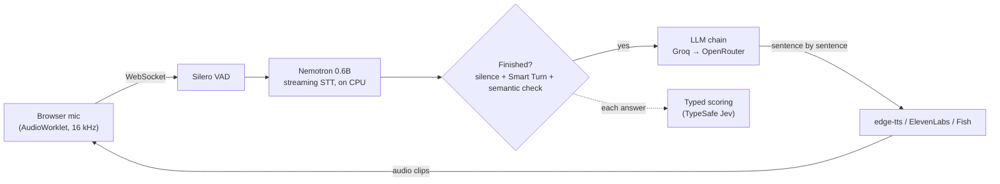

# AI Interviewer

**[Live demo](https://shiivamchauhan-ai-interviewer.hf.space)** · **[API docs](https://shiivamchauhan-ai-interviewer.hf.space/docs)**
(free hosting: give it two minutes if it was asleep)

A real-time voice interviewer that listens properly. It reads the JD, the candidate's resume and their
repositories, runs the screening interview by voice, waits until the candidate has actually finished (a pause
to think is not the end of a turn), answers in a second or two, and hands back a structured result: every
answer with its transcript, timing and scores, delivery metrics, and a hiring-manager report.

It runs on a CPU. Speech recognition is local; the LLMs and voices use hosted APIs with automatic failover.

Try it in the browser as the candidate, or create interviews from your own product through the API.
Optional preparation (off by default, so the interview starts right away) analyses the JD and the resume,
reads the attached repositories, plans unique questions per section and has a bar-raiser review the plan.

## The API

```bash
curl -X POST https://shiivamchauhan-ai-interviewer.hf.space/api/v1/sessions \
  -H "Content-Type: application/json" \
  -d '{"agent": "interview",
       "setup": {"candidate_name": "Priya", "role": "Backend Engineer", "duration_min": 10,
                 "jd": "Payment APIs in Python and Postgres"},
       "metadata": {"candidate_id": "c-1042"}}'
# -> {"id": "...", "status": "created", "join_url": "https://.../?session=...", ...}
```

Send `join_url` to the candidate. They open it, do a ten-second voice check and take the interview; they don't
see the report. Then:

- `GET /api/v1/sessions/{id}` returns the status (`created` → `live` → `completed` / `abandoned`, or `expired`
  after a day unused) and, once it's over, the `result`: `turns` (question, answer, verbatim transcript,
  response time, pauses, per-answer scores), `delivery`, `report_markdown`, plus what the agent prepared.
- Or pass `webhook_url` and get the same JSON POSTed to you, signed with `X-Signature: sha256=<HMAC of the
  body>` using `WEBHOOK_SECRET`, retried with backoff.
- With `API_TOKENS` set, every call needs `Authorization: Bearer <token>`.

[`examples/api_client.py`](examples/api_client.py) does the whole round trip, and `/docs` has the
interactive reference. The fields under `setup` are the setup screen's; `GET /api/interview/options` lists
them with their defaults. Pass `"overrides": {"prep": {"enabled": true}}` to prepare before the interview.

## How it works



The parts that took the longest:

- **Not cutting people off.** Silence alone is a bad signal: people pause to think, restart sentences and get
  stuck on words. Three signals vote, cheapest first: silence (Silero VAD), Smart Turn (does the audio *sound*
  finished?) and a semantic check (is the *thought* finished?). A trailing "and..." or "let me think" buys
  time. The rules are one pure function, [`end_reason`](app/core/turns.py), pinned down by
  [`tests/test_turn_end.py`](tests/test_turn_end.py).
- **Only the right voice counts.** The voice check takes a TitaNet voice print, so the TV, a colleague and
  the interviewer's own echo are ignored.
- **A second or two to reply.** The LLM streams into the voice sentence by sentence (the first clause is cut
  short so audio starts early), TTS sockets stay warm, a slow edge-tts request is raced against a spare
  socket, and common openers are cached. Measured on the live demo, end of turn to first audio: 1–2.5 s with
  Fish (the default voice, the most human-sounding), 0.8–1.2 s with edge-tts.
- **It keeps working when a provider doesn't.** Every provider takes several keys; a rate limit benches that
  key for that model only ([`keypool.py`](app/llm/keypool.py)). A model that hasn't started answering in 6 s
  is skipped, a premium voice slower than 6 s falls back to edge-tts, and edge-tts falls back to Kokoro offline.
- **Scores you can rely on.** Grading never asks for free text: each answer goes to a typed classifier and
  comes back as fixed rubric levels (correctness, depth, communication), a yes/no for on-topic and one of five
  next moves. Planning steps return JSON; broken JSON falls through to the next model.

Delivery metrics (pace, response time, long pauses, fillers, answer length) describe *how* things were said.
They are reported separately and never feed the scores.

## Run it

```powershell
start.bat        # sets everything up, then opens http://127.0.0.1:8000 (Chrome/Edge)
```

Put your keys in `.env` (copy `.env.example`). Every `*_API_KEYS` takes a comma-separated list:

| Key | For |
|---|---|
| `GROQ_API_KEYS` | the interviewer's LLM, plus Whisper for the final transcripts |
| `OPENROUTER_API_KEYS` | backup LLM |
| `JEV_API_KEYS`, `SCALEDOWN_API_KEYS` | the semantic end-of-turn check and answer scoring |
| `FISH_API_KEYS`, `ELEVENLABS_API_KEYS` | premium voices (edge-tts works without any key) |

`python -m scripts.check_keys` tells you which keys work. Everything the interviewer does (prompts,
preparation, scoring, timings, voices, models) lives in `config/*.yaml`, and the **Settings** page edits it.

## Develop

```powershell
pip install -r requirements-dev.txt
pytest                                                    # turn-taking, API, key rotation, metrics, storage
ruff check .
python -m scripts.smoke_test --api                        # a synthetic candidate does a whole interview via the API
```

## Deploy

The live demo is a free Hugging Face Space. Free accounts only get Gradio on ZeroGPU these days, so
[`space.py`](space.py) registers a GPU function that never runs (ZeroGPU won't boot without one) and then
serves the real app. Public mode: one session at a time, nothing saved, settings read-only, sessions capped at
20 minutes, no webhooks and no session listing.

```powershell
python -m scripts.deploy_space you/ai-interviewer --secrets   # needs HF_TOKEN in .env
```

Anywhere that runs containers, the [`Dockerfile`](Dockerfile) does the same job. On your own server, set
`API_TOKENS`, `WEBHOOK_SECRET` and `PUBLIC_URL`.
