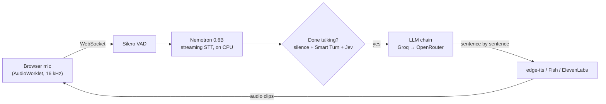

# Practice Studio

**[Try it live](https://shiivamchauhan-practice-studio.hf.space)** (free CPU, so give it a minute if it was asleep)

Voice practice for the three things I'd rather avoid: **job interviews**, **phone calls** and **small talk
with strangers**. I also stammer. Most voice AIs take a two-second block as their cue to interrupt. This one
waits.

It runs on a laptop CPU and costs ₹0. Speech recognition is local, and the LLMs and voices use free tiers,
switching to the next key whenever one runs dry.

## Modes

- **🎯 Interview:** reads your JD, resume and project repos, plans fresh questions, interviews you by voice,
  then writes a hiring-manager report.
- **📞 Phone call:** a random caller rings you (delivery guy, recruiter, scammer...), or you have to call
  someone and get a thing done. Phone-line audio included, awkward silences optional.
- **💬 Conversation:** chat with a stranger whose accent, age, job and personality you design.

Every session ends with feedback plus a speech report: how much you stammered, how nervous you sounded, and
whether you settled down. These are estimates for practice, not a diagnosis.

## How it works



The parts that took the longest:

- **Not interrupting a stammer.** A pause isn't the end of a turn, so three signals vote: silence, Smart Turn
  (does it *sound* finished?) and Jev (is the *thought* finished?). A trailing "and..." or a "let me think"
  buys extra time. The rules live in [`app/core/turns.py`](app/core/turns.py) and are pinned down by
  [`tests/test_turn_end.py`](tests/test_turn_end.py).
- **Ignoring the TV.** The mic check takes a voice print (TitaNet). Other voices, and the partner's own echo,
  don't count as you.
- **About a second to reply, on free tiers.** The first sentence is cut short so the voice starts early, TTS
  sockets stay warm, a slow edge-tts request gets raced against a spare socket, and a model that hasn't said
  anything in 6 seconds gets skipped.
- **₹0, more or less forever.** Every provider takes several keys. A rate limit benches that key for that model
  only, and the next key takes over ([`app/llm/keypool.py`](app/llm/keypool.py)).
- **Doing the homework.** Before the first question the interviewer reads the JD, the resume and the code in
  your repos (cached per commit), then plans questions it hasn't asked you before.

## Run it

```powershell
start.bat        # sets everything up, then opens http://127.0.0.1:8000 (Chrome/Edge)
```

Put your keys in `.env` (copy `.env.example`). Every `*_API_KEYS` takes a comma-separated list:

| Key | For |
|---|---|
| `GROQ_API_KEYS` | the brain + Whisper |
| `OPENROUTER_API_KEYS` | backup brain |
| `JEV_API_KEYS`, `SCALEDOWN_API_KEYS` | "are they done talking?", answer grading |
| `FISH_API_KEYS` | expressive voices that can sigh and sound sceptical (free model) |
| `ELEVENLABS_API_KEYS` | the most natural voices |

No voice keys? You get edge-tts, which is free and perfectly fine. `python -m scripts.check_keys` tells you
which keys work.

All behaviour (prompts, personas, scenarios, timings, voices, models) lives in `config/*.yaml`, and the
**Settings** page edits it. Changes apply from the next session.

## Develop

```powershell
pip install -r requirements-dev.txt
pytest                                                # turn-taking, key rotation, analysis, storage
ruff check .
python -m scripts.smoke_test --mode phone --report    # a fake user with a fake stammer calls the running app
```

## Deploy

The live demo is a free Hugging Face Space built from the [`Dockerfile`](Dockerfile). It runs in public mode:
one visitor at a time, nothing saved, settings read-only, sessions capped at 20 minutes.

```powershell
python -m scripts.deploy_space you/practice-studio --secrets   # needs HF_TOKEN in .env
```
